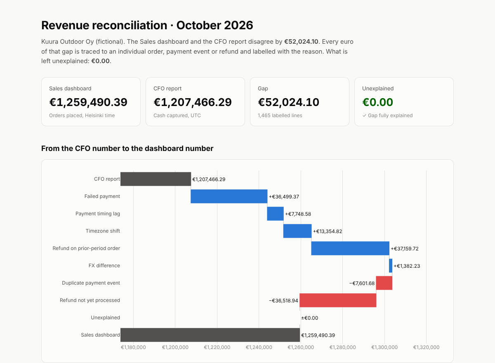
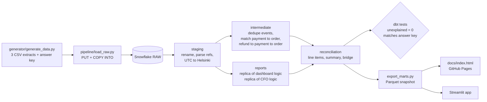
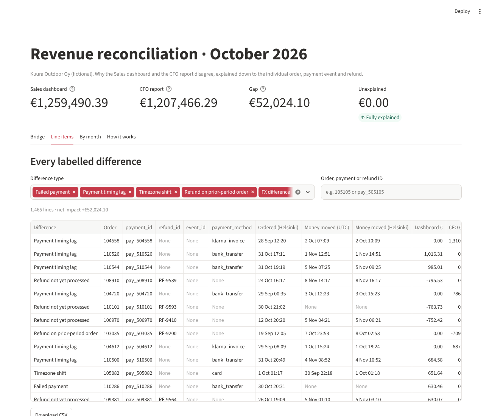

# Revenue reconciliation: why the CFO and the dashboard disagree


**Live report:** https://munyingi.github.io/revenue-reconciliation/ · **Streamlit app:** _add link after deploying_

The CFO's report says October revenue was **€1,207,466.29**. The sales dashboard says **€1,259,490.39**.
Nobody trusts either number, and the data team is asked to find out why.

This project rebuilds both numbers from three source systems, matches every order to its payments
and refunds, and labels each difference. The result is a bridge from one number to the other where the
unexplained remainder is **exactly €0.00**, enforced by dbt tests.



| Step | Amount | Lines |
|---|---:|---:|
| **CFO report** | **€1,207,466.29** | |
| Failed payment | +€36,499.37 | 168 |
| Payment timing lag | +€7,748.58 | 225 |
| Timezone shift | +€13,354.82 | 72 |
| Refund on prior-period order | +€37,159.72 | 179 |
| FX difference | +€1,382.23 | 611 |
| Duplicate payment event | −€7,601.68 | 31 |
| Refund not yet processed | −€36,518.94 | 179 |
| Unexplained | **€0.00** | |
| **Sales dashboard** | **€1,259,490.39** | |

## The business problem

Kuura Outdoor Oy (fictional) is a Helsinki web shop selling to Finland, Sweden and Norway. Three systems
record the same money differently:

| System | Clock | What it records |
|---|---|---|
| **Order system** (shop) | Helsinki local time, no timezone stored | Orders when placed. Refunds when customer service *approves* them. EUR at a fixed catalogue rate. |
| **Payment provider** (PSP) | UTC | Webhook events when money is *captured*. Settles SEK/NOK at its own rate. Sometimes delivers an event twice. |
| **Refund tool** | UTC | Refunds when money actually *leaves*. Only knows the PSP `payment_id`, never the order. |

The **Sales dashboard** reads the order system: orders placed in the Helsinki month, minus approved refunds.
The **CFO report** reads the PSP and refund tool: cash captured in the UTC month, minus refunds paid out.
Both are reasonable. Neither is wrong on its own terms. They just answer different questions.

## The seven differences

| Label | What happened | How it is detected |
|---|---|---|
| `failed_payment` | Card declined or bank transfer never paid. The shop leaves the order open, so the dashboard counts it. | Order in period, PSP outcome is `failed` / `expired` |
| `payment_timing_lag` | Klarna invoices are captured on shipment, bank transfers arrive 1 to 5 days later. Orders from 28 Sep land in October cash; orders from 30 Oct land in November. | Order and capture fall in different **Helsinki** months |
| `timezone_shift` | An autumn campaign launched at 00:00 Helsinki on 1 October. Those orders are still 30 September in UTC (UTC+3 before DST ended on 25 Oct). | Order and capture are in the **same** Helsinki month, but different UTC months |
| `duplicate_payment` | The PSP redelivered a capture webhook with a new `event_id`. Finance summed every event. | Deduplicate on `(payment_id, event_status)`; every extra delivery is a line |
| `refund_not_yet_processed` | Refund approved in October (dashboard nets it), money returned in November or still pending (finance does not). | Refund on an in-period order, not processed in period |
| `refund_prior_period_order` | Refund paid out in October for a September order. Finance deducts it; the dashboard does not, because the order is not in October. | Refund processed in period, order outside period |
| `fx_difference` | SEK/NOK orders: the shop converts at a catalogue rate, the PSP settles at its own (slightly worse) rate. | Both reports include the order, amounts differ |

Two more labels exist for safety, `unmatched_payment` and `unmatched_refund`. No flaw was planted for
them, so they are empty, but anything that cannot be joined lands there instead of disappearing.

## How it works



1. **Generate.** `generator/generate_data.py` creates ~12k orders (1 Sep to 10 Nov 2026; 5,650 in October),
   12k payment events and 626 refunds with the flaws above built in. Fixed seed, so output is reproducible.
2. **Load.** `pipeline/load_raw.py` creates typed tables in `RAW` (money as `NUMBER(12,2)`, never float) and
   loads the CSVs with `PUT` to an internal stage and `COPY INTO`.
3. **Rebuild both numbers.** `rpt_sales_dashboard__monthly` and `rpt_cfo_revenue__monthly` reproduce each
   team's logic, flaws included. If the replicas did not match the real reports, nothing downstream would mean anything.
4. **Match.** Events are deduplicated, PSP references (`ORD00105105`) are parsed to order IDs, and refunds are
   walked `refund → payment → order`. Full outer joins keep orphans visible.
5. **Label.** `recon_line_items` computes, for every order, extra event and refund, what each report counted.
   Every non-zero difference gets exactly one label.
6. **Prove it.** `recon_summary` computes `dashboard − CFO − Σ labelled differences`. Tests fail the build if it is not 0.

### Streamlit explorer

Filter by difference type, search any order, payment or refund ID, and download the lines as CSV.



## Why the tests are meaningful

The four singular tests in `dbt/tests/`:

- **`assert_gap_fully_explained`**: the unexplained remainder must be exactly €0.00.
- **`assert_bridge_lands_on_dashboard`**: walking the waterfall from the CFO number must land on the dashboard number.
- **`assert_matches_planted_answer_key`**: the generator records the impact of every flaw it planted in
  `dbt/seeds/answer_key.csv`. It labels by *cause* (e.g. "card payments only cross a month because of
  timezones"), while the SQL labels by *observable evidence* (e.g. "same Helsinki month, different UTC month").
  Two independent methods have to agree to the cent and to the line count.
- **`assert_refund_totals_agree_across_systems`**: the dashboard nets refunds from the order system, the
  reconciliation uses the refund tool. If they ever disagreed, the bridge would be wrong.

The tests do fail when the logic is wrong: removing duplicate detection breaks three of them.

## Run it

### Snowflake (primary)

```bash
python -m venv .venv && source .venv/bin/activate
pip install -r requirements-pipeline.txt

# 1. Run snowflake/setup.sql once in a Snowflake worksheet (creates RECON_ROLE, RECON_WH, REVENUE_RECON.RAW)
# 2. Credentials
cp .env.example .env   # fill in
set -a; source .env; set +a

make all TARGET=snowflake   # generate, load, dbt build, export snapshot, build report
make app                    # Streamlit on localhost:8501
```

### Local, no account needed (DuckDB)

```bash
pip install -r requirements-pipeline.txt
make all            # same pipeline on data/warehouse.duckdb
```

The SQL is shared; the only adapter-specific code is the timezone conversion
(`convert_timezone` on Snowflake, `timezone()` on DuckDB) in `dbt/macros/time.sql`.
CI runs the DuckDB target on every push.

### Reconcile another month

```bash
cd dbt && dbt build --profiles-dir . --vars '{recon_month: "2026-09-01"}'
```

## Project structure

```
generator/generate_data.py      fake source data + answer key
pipeline/load_raw.py            CSV -> RAW (Snowflake stage + COPY INTO, or DuckDB)
pipeline/export_marts.py        marts -> app/data/*.parquet
dbt/
  models/staging/               one model per source table
  models/intermediate/          dedupe, payment matching, refund matching
  models/reports/               replicas of the dashboard and CFO logic
  models/reconciliation/        line items, summary, bridge
  macros/time.sql               UTC -> Helsinki, period boundaries
  tests/                        gap = 0, bridge ties, answer key, cross-system refunds
  seeds/answer_key.csv          expected impact of each planted flaw
reports/build_report.py         docs/index.html (GitHub Pages)
app/streamlit_app.py            interactive explorer
snowflake/setup.sql             role, warehouse, database
```

## Details worth noticing

- **DST.** Helsinki was UTC+3 on 1 October and UTC+2 on 1 November, so the timezone window is three hours at the
  start of the month and two at the end. On 25 October, 03:00 to 04:00 happens twice. The pipeline never converts
  local shop time to UTC (that is ambiguous); it only converts UTC to Helsinki, which is not.
- **Exact money.** Amounts are `NUMBER(12,2)` end to end, so the remainder is 0.00, not 1.4e-9.
- **Duplicate key.** Duplicates have different `event_id`s, so deduplicating on `event_id` misses them. The
  business key is `(payment_id, event_status)`: a payment can only be captured once.
- **Neither number is "right".** The output does not pick a winner. It tells finance and sales exactly which
  definition causes each euro of difference, which is what they need to agree on one definition.

## What I would add in production

- Run monthly as part of close, with the bridge stored per month so differences can be tracked over time.
- Alert when `unmatched_payment` / `unmatched_refund` are non-zero, or when failed payments spike.
- Feed `failed_payment` orders back to the shop team: they should be cancelled automatically.
- Use dbt snapshots on the order table, so the dashboard number can be reproduced as of any date.

---
All data is synthetic. Kuura Outdoor Oy is not a real company.
